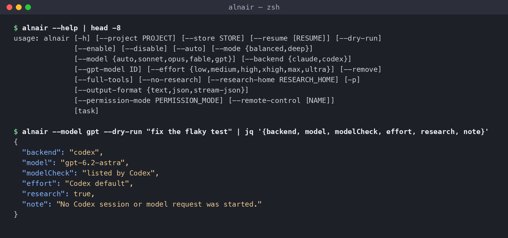

# Alnair

[](https://github.com/mahimn01/alnair/actions/workflows/ci.yml)
[](LICENSE)

A terminal harness that works with Claude and ChatGPT/Codex models. It picks the model for each task, remembers what a long session settled, and checks quotes against the files they came from.

Alnair starts an ordinary interactive session on your own subscription: Claude Code for Claude models (Sonnet, Opus, Fable), or the Codex CLI on your ChatGPT login for GPT models such as GPT-6.2-Astra. Both get the same memory, research tools and session notes. It never edits `~/.claude`, and on the Codex side it only adds two MCP servers to `~/.codex/config.toml`, after a backup. I built it because my long sessions kept hitting the same three problems: Opus got spent on renaming variables, important facts vanished at compaction, and research answers cited pages that didn't say what the answer claimed.



*Real output of `alnair --help` and `alnair --model gpt --dry-run`, from a fresh clone in a scratch home folder. A dry run starts no session.*

## What it does

- **Claude and GPT in one harness.** `alnair` runs Claude Code. `alnair --model gpt` runs Codex on GPT-6.2-Astra (or any model Codex lists) with the same memory and research tools, and both write to the same session ledger.
- **Model routing for Claude.** Each task goes to Sonnet, Opus or Fable based on what you asked. You can override it per launch or per task.
- **Session memory that survives compaction.** Durable facts go into a ledger under `~/.clp/sessions/<id>/`, each with a file address and a SHA-256. A read whose hash no longer matches is refused, so stale memory can't come back as fact.
- **Notes lookup with a verify gate.** CLP (Context Ledger Protocol) indexes a copy of your notes folder. The model looks things up, reads the exact lines, and runs `verify` before presenting a claim. A claim whose quote isn't in the cited lines is refused.
- **Keyless research tools.** Papers (arXiv, OpenAlex, Crossref, Semantic Scholar), SEC filings, patents, court records, Wayback snapshots and market data, all without API keys. Research reports only pass when every quote matches the saved source word for word.
- **Session notes.** When a session stops, ends or compacts, a hook writes one Markdown note for it into your notes vault (Obsidian works). It only ever edits the notes it created.
- **Interactive only.** `-p`/`--print`, `codex exec` and the other headless modes are refused, and there's no API-key fallback, so a session can't quietly start billing an API account.
- **Remote Control.** `alnair --remote-control` turns on Claude Code's Remote Control so you can follow a session from your phone.

The memory layer comes from my research on CLP. The protocol, its paper experiments and the measured results are in [mahimn01/context-ledger](https://github.com/mahimn01/context-ledger). This repo is the day-to-day harness built on it.

## Quickstart

You need macOS or Linux, Python 3.10+, Node 20+ and git. For Claude models, install Claude Code with Anthropic's native installer (it lands at `~/.local/bin/claude`) and sign in once. For GPT models, install the Codex CLI and sign in with ChatGPT:

```sh
brew install --cask codex      # or: npm install -g @openai/codex
codex login                    # choose "Sign in with ChatGPT"
```

Then:

```sh
git clone https://github.com/mahimn01/alnair.git ~/alnair
cd ~/alnair
./install.sh
alnair doctor
alnair                  # Claude
alnair --model gpt      # GPT-6.2-Astra through Codex
```

`install.sh` links `alnair` and `claude-lab-clp` (the old name) into `~/.local/bin`, creates `~/.clp` and the run folders under `~/.local/state`, makes a Python venv inside the checkout, and writes `~/.config/alnair/config.env` once. When `codex` is on your PATH it also adds Alnair's two MCP servers to `~/.codex/config.toml` between marker comments, saving `config.toml.alnair-backup-<time>` first. It's safe to run again. It never writes `~/.claude/settings.json`, `~/.claude.json` or anything else under `~/.claude`.

```sh
./install.sh --vault ~/Notes          # notes folder for session notes (default ~/Documents/Obsidian Vault)
./install.sh --bin ~/bin              # put the commands somewhere other than ~/.local/bin
./install.sh --skip-python-deps       # skip the optional page-extraction package
./install.sh --skip-codex             # leave ~/.codex/config.toml alone
```

To update, `git pull` and run `./install.sh` again. The lab rewrites `lab/plugin/hooks/model-catalog.js` when Claude Code advertises a new model alias, so if git refuses to pull, run `git checkout lab/plugin/hooks/model-catalog.js` first.

macOS is what I use every day. Linux should work but hasn't been tested yet. Windows isn't supported: the launcher assumes POSIX paths, so use WSL.

## Using it

```sh
alnair                        # Claude session in the current folder
alnair "fix the flaky test"   # start with a prompt
alnair --resume latest        # pick up the last run with the same memory tools
alnair demo                   # small demo project plus a sample notes corpus
alnair doctor                 # offline readiness report for Claude and Codex, no model call
alnair --dry-run "..."        # print the exact command and settings, start nothing
alnair --no-research          # leave the research tools out
alnair --remote-control       # turn on Claude Code Remote Control
alnair --remote-control=desk "fix the flaky test"   # same, with a session name
alnair codex-setup            # add or refresh Alnair's entries in ~/.codex/config.toml
alnair codex-setup --remove   # take them back out (after another backup)
```

Index your notes once so lookups have something to search. This copies the folder into `~/.clp` and never writes to the original:

```sh
~/alnair/.venv/bin/python ~/alnair/claude-clp/bin/clp_tool.py init            # your configured vault
~/alnair/.venv/bin/python ~/alnair/claude-clp/bin/clp_tool.py init ~/Notes    # or any folder
```

`--remote-control` passes Claude Code's own `--remote-control [name]` flag through. Remote Control needs Claude Code signed in with a claude.ai account and doesn't work with an API key. You can also type `/remote-control` inside a session that's already running. If you give both a name and a prompt, use the `--remote-control=NAME` form so the prompt isn't read as the name.

## GPT models through Codex

```sh
alnair --model gpt "..."                          # GPT-6.2-Astra (model id gpt-6.2-astra)
alnair --model gpt --effort high "..."            # low, medium, high, xhigh, max or ultra
alnair --model gpt --gpt-model gpt-6.2-sol "..."  # any other model Codex lists
alnair --backend codex "..."                      # same as --model gpt
alnair --model gpt --resume                       # codex resume --last, with Alnair's tools
alnair --model gpt -- -s workspace-write          # anything after -- goes to codex
```

The session is the normal Codex TUI on your ChatGPT plan. Alnair passes these for that session only, as `-c` overrides:

- the model and the project folder
- a short developer note on using the memory and research tools, and on how to switch models
- the `alnair_clp` and `alnair_research` MCP servers
- `forced_login_method="chatgpt"`
- session-note hooks on `Stop`, `PreCompact` and `SessionEnd`

It also removes `OPENAI_API_KEY` and `CODEX_API_KEY` from the session's environment so Codex can't fall back to API billing.

The model id comes from Codex's own model list (`codex debug models`). Alnair checks your choice against the copy Codex keeps in `~/.codex/models_cache.json` and refuses a model it doesn't list. One exception: when that copy was written by an older Codex than the one you have installed, it lets the model through, because an older Codex gets a shorter list from OpenAI. (A long-running Codex app-server or the desktop app can rewrite that file with its own older list.) Set `ALNAIR_GPT_MODEL` in `config.env` to change the default. If GPT-6.2-Astra is missing from `codex debug models`, update Codex (`brew upgrade --cask codex`).

Codex asks you to review new hooks before it runs them. The first time, open `/hooks` in the session and trust Alnair's session-note hook. Until you do, Codex skips it and no note is written. Alnair never bypasses that check.

Inside Codex, `/model` switches between GPT models. To switch to Claude you exit and run `alnair` (or `alnair --model opus`). Inside a Claude session, `/lab-model gpt` tells you the same thing the other way round. The two sessions share `~/.clp/sessions`, so `session_lookup` with `latest` or a listed id picks up what the other one saved.

What doesn't carry over to Codex:

- automatic Sonnet/Opus/Fable routing, which runs inside Claude Code
- the lab status line and subagent rules
- `--remote-control` (Codex has its own `codex remote-control`)
- the paid `clp ask` tool

Codex's session transcript format isn't a stable interface, so a Codex update can thin out what the session notes capture until the parser catches up.

## Choosing a Claude model

```sh
alnair --model auto "..."     # the default
alnair --model sonnet "..."
alnair --model opus "..."
alnair --model fable "..."
```

The choices are `auto`, `gpt`, and every alias in `lab/plugin/hooks/model-catalog.js`, which today means `sonnet`, `opus` and `fable`. Full Claude model ids such as `claude-opus-5-5` are rejected, and so is `--model` after `--`, because both would skip the router. For Sonnet and Opus, Alnair hands Claude Code the alias, so `opus` always means the newest Opus your Claude Code ships. Fable is passed as the full id in the catalog (`claude-fable-5-2` right now), and the lab updates that id when a session reports a newer one.

With `auto`, the router reads your prompt:

| Prompt looks like | Model | Effort |
|---|---|---|
| long-horizon or extremely hard work: open research problems, formal verification, many repositories | Fable if available, otherwise Opus | xhigh |
| architecture, security, proofs, root causes, race conditions, anything ambiguous | Opus | xhigh |
| brokerage or options-trading work | Sonnet, plus a required Opus review | high |
| everything else | Sonnet | medium |

Auto never picks GPT. Claude and Codex are separate programs, so changing backends means a new session, and I have no measured basis yet for sending a given prompt to GPT rather than Opus or Fable. Picking GPT is up to you.

Start `alnair` with no prompt and your first message picks the model. Inside a session, `/lab-model auto|sonnet|opus|fable` sets the model for the next task, and adding `now` switches straight away. Subagents get Opus for review and hard reasoning and Sonnet for the rest. An explicit Haiku or Sonnet request for a subagent is kept.

Fable is gated. `alnair fable-check` looks in your local Claude Code transcripts for an interactive Fable reply from the last 7 days and enables Fable only if it finds one. `alnair fable-check --enable` or `--disable` overrides that by hand. The check makes no model call.

New Claude models show up on their own. Once a day, or right away when the Claude Code binary changes, Alnair reads the aliases listed in `claude --help` and adds any new one to the catalog, after which it's a valid `--model` choice. `alnair update` forces that check. Auto-routing only picks Sonnet, Opus or Fable, so a new alias has to be chosen by name.

## Settings

`~/.config/alnair/config.env` holds `KEY=VALUE` lines. Anything exported in your shell wins over the file.

| Key | Default | What it changes |
|---|---|---|
| `ALNAIR_VAULT` | `~/Documents/Obsidian Vault` | where session notes go, and what `clp_tool.py init` indexes by default |
| `ALNAIR_GPT_MODEL` | `gpt-6.2-astra` | the Codex model `--model gpt` uses |
| `CLP_STORE` | `~/.clp` | corpus copies and session ledgers |
| `RESEARCH_HOME` | `~/.clp/research` | saved research sources and claims |
| `RESEARCH_MAILTO` | unset | contact address sent to Crossref, OpenAlex and SEC. SEC full-text search wants one |
| `ALNAIR_TZ` | `America/Toronto` | time zone used in session note titles |
| `ALNAIR_LAB_ROOT` | `lab/` in the checkout | use a different copy of the lab shell |
| `CONTEXT_LEDGER_RESEARCH_API_KEY` | unset | only for the optional paid `clp ask` command. Sessions never use it |

`CODEX_HOME` is respected if you've moved Codex's folder.

## How it compares

**Plain Claude Code or plain Codex.** Alnair is those programs. It adds routing on the Claude side, the memory and research tools on both, session notes and a status line, and it passes everything per run. Your normal `claude` and `codex` commands behave as before. The only lasting change is the two MCP servers in `~/.codex/config.toml`, which plain `codex` sessions can use too.

**Memory plugins that summarise past sessions.** Those inject recalled text that the model can't check. Alnair's memory is addressed: every fact points at a file, a line range and a hash, and the verify gate refuses a quote that isn't there. Recall is weaker in exchange, because nothing gets remembered that wasn't written down.

**context-ledger.** [context-ledger](https://github.com/mahimn01/context-ledger) is the research code and paper for CLP. Alnair ships the same library in `src/context_ledger/` and uses it for notes lookup and the gate.

## FAQ

**Does it use my API key?** No. Claude sessions run on your Claude Code login and Codex sessions on your ChatGPT login. Alnair strips `OPENAI_API_KEY` and `CODEX_API_KEY` from Codex sessions. The only paid path is the optional `clp ask` command, which reads `CONTEXT_LEDGER_RESEARCH_API_KEY`, stops at a $5 daily cap, and isn't offered to Codex at all.

**Will it change my settings?** It never writes Claude Code's settings. It reads `~/.claude/settings.json` to build the run's layer and passes that layer with `--settings`, and the test suite checks that a launch leaves those files byte-identical. On the Codex side, `install.sh` adds one marked block to `~/.codex/config.toml` after a backup, and `alnair codex-setup --remove` takes it out again.

**Why no headless mode?** The subscription I built it on refuses headless calls with a 403, and silently falling back to an API key is how surprise bills happen. The same rule covers `codex exec`.

**Does it need Obsidian?** No. Any folder of Markdown, text or Python files works as the notes corpus, and session notes are plain Markdown.

**What happened to the desktop app?** I removed it in 0.2.0. The terminal harness is the part I use, so that's what this repo is now.

## Roadmap

- measure Claude against GPT on the routing benchmark, and only then let auto-routing choose between them
- test and document Linux properly, including account switching without the macOS Keychain
- let auto-routing consider newly discovered Claude model aliases
- bring the lab status line to Codex sessions

## Repo layout

- `claude-mem/` holds the `alnair` launcher (`bin/claude-lab-clp`), the Codex backend (`bin/codex_backend.py`), the routing benchmark and an optional Rune terminal layout
- `lab/` is the Claude session layer: launcher, model router, status line and the optional account switcher ([lab/README.md](lab/README.md))
- `claude-clp/` is the CLP plugin, its MCP server for Codex (`bin/clp_mcp.py`), the session ledger and the session note hook
- `claude-research/` is the research plugin and its MCP server
- `src/context_ledger/` is the CLP library

## Contributing

Bug reports and pull requests are welcome. [CONTRIBUTING.md](CONTRIBUTING.md) covers running the tests (none of them start a Claude or Codex session), and [SECURITY.md](SECURITY.md) says how to report a vulnerability privately.

MIT licensed. See [LICENSE](LICENSE).
