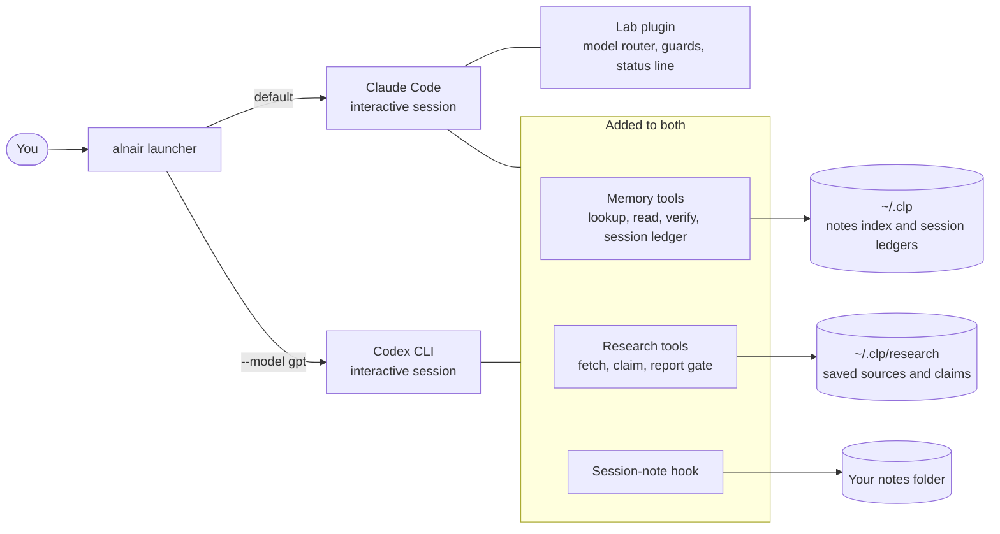

# Alnair

[](https://github.com/mahimn01/alnair/actions/workflows/ci.yml)
[](LICENSE)

**Claude Code and Codex with a model router, memory that survives compaction, and answers checked against their sources.**

Alnair is a launcher for the Claude Code and Codex command-line tools. It starts their normal interactive session on your own subscription and adds three things. It picks the Claude model for each task. It keeps what a long session settled in a ledger the model can read back. And it refuses an answer whose quote is not in the file or page it cites. It never edits `~/.claude`.


*Real output of `alnair --help` and `alnair --model gpt --dry-run`, captured from a fresh clone in a scratch home folder and rendered as an image. A dry run starts no session.*

## Why I built it

My long sessions kept hitting the same three problems.

- **Opus got spent on renaming variables.** A session runs every task on the model it started with unless you switch by hand.
- **Important facts vanished at compaction.** Once the context was summarised, a decision from an hour earlier could be gone.
- **Research answers cited pages that didn't say what the answer claimed.**

Alnair is the harness I use every day to deal with those three. It is still Claude Code or Codex underneath, so what you already know about them carries over.

## What you get

- **Model routing for Claude.** Each task goes to Sonnet, Opus or Fable based on what you asked. You can override it per launch (`--model opus`) or per task (`/lab-model`).
- **Session memory that survives compaction.** Durable facts go into a ledger under `~/.clp/sessions/<id>/`, each with a file address and a SHA-256. A read whose hash no longer matches is refused, so stale memory can't come back as fact.
- **A verify gate for your notes.** CLP (Context Ledger Protocol) indexes a copy of your notes folder. The model looks things up, reads the exact lines, and runs `verify` before presenting a claim. A claim whose quote isn't in the cited lines is refused. You can [try the gate yourself](#try-the-verify-gate-without-a-session) in half a minute.
- **Research tools that need no API keys.** Papers (arXiv, OpenAlex, Crossref, Semantic Scholar), SEC filings, patents, court records, Wayback snapshots and market data. A research report only passes when every quote matches the saved source word for word.
- **Claude and GPT in one harness.** `alnair --model gpt` runs the Codex CLI on your ChatGPT login with the same memory and research tools, and both write to the same session ledger.
- **Session notes.** When a session stops, ends or compacts, a hook writes one Markdown note for it into your notes folder (Obsidian works). It only ever edits the notes it created.
- **Interactive only, on your subscription.** `-p`/`--print`, `codex exec` and the other headless modes are refused, and there's no API-key fallback, so a session can't quietly start billing an API account.

The memory layer comes from my research on CLP. The protocol, its paper experiments and the measured results are in [mahimn01/context-ledger](https://github.com/mahimn01/context-ledger). This repo is the day-to-day harness built on it.

## Quickstart

You need Python 3.10+, Node 20+, git, and [Claude Code](https://code.claude.com/docs/en/setup) installed with Anthropic's native installer and signed in once.

macOS and Linux:

```sh
curl -fsSL https://raw.githubusercontent.com/mahimn01/alnair/main/get.sh | bash
alnair doctor     # checks the install offline, with no model call
alnair            # start a session in the current folder
```

Windows 10 and 11, in PowerShell, with no WSL (Git for Windows must be installed):

```powershell
irm https://raw.githubusercontent.com/mahimn01/alnair/main/get.ps1 | iex
alnair doctor
```

Everything the installer does:

- clones this repository into `~/alnair`, makes a Python venv inside it, and installs the optional page-extraction package into that venv
- links `alnair` (and its old name, `claude-lab-clp`) into `~/.local/bin`
- creates `~/.clp` for memory and saved research, run folders under `~/.local/state`, and `~/.config/alnair/config.env` for settings
- if the Codex CLI is installed, adds two MCP servers to `~/.codex/config.toml` between marker comments, after saving a backup

It never writes `~/.claude/settings.json`, `~/.claude.json` or anything else under `~/.claude`. If you would rather read before you run, [get.sh](get.sh) and [install.sh](install.sh) are short, or clone the repository and run `./install.sh` yourself. [docs/install.md](docs/install.md) covers the options, updating and [removing it](docs/install.md#removing-it).

One default to know about: when a session ends, a note about it is written to `~/Documents/Obsidian Vault/Claude Sessions`, and that folder is created if it isn't there. To use your own notes folder, install with `curl -fsSL .../get.sh | ALNAIR_VAULT=~/Notes bash` or set `ALNAIR_VAULT` in `config.env` afterwards.

For GPT models, install the Codex CLI, run `codex login`, and start `alnair --model gpt`. Details are in [docs/codex.md](docs/codex.md).

## Try the verify gate without a session

This runs the gate on a two-note sample. It makes no model call, uses no network, and writes only to a temporary folder that it deletes.

```sh
~/alnair/examples/verify-gate.sh
```

The last three of its five steps print this. It is real output, copied from a run:

```text
== 3. Read the exact lines at AMZN.md:1-4#a07561d9
[AMZN.md:1-4#a07561d9]  lines 1-4 of 5
# AMZN

Exit plan: sell if a daily close is 25% below the highest close since the first buy.
Working order: BUY 22 @ $223 GTC.

== 4. Verify an answer that quotes the note word for word
PASS: verified against your files.
Answer: The exit plan is to sell if a daily close is 25% below the highest close since the first buy.
Why: every claim quotes your files word for word, and every number or name in the answer is in those quotes.
Sources:
  [1] AMZN.md lines 1-4: "sell if a daily close is 25% below the highest close since the first buy"
Present the ANSWER and these claims as the verified part; label anything else you add as not verified.

== 5. Verify an answer that gets the number wrong (25% became 20%)
REFUSED: not verified (2 problems). Do not present this answer as fact.
- claim 1, citation 1: the quote is not in AMZN.md:1-4 word for word. Read those lines again and copy the quote exactly, or cite the lines that hold it.
- answer: `20` in the ANSWER line is not in any verbatim quote you cite. Quote the line that gives it, or leave it out.
Repair: read the lines that hold each value, copy quotes exactly, and verify again; or answer UNANSWERABLE.
```

Inside a session the model runs these same steps before it tells you what your notes say. `alnair demo` starts a session on a small demo project with this sample corpus.

## Everyday commands

```sh
alnair                        # Claude session in the current folder
alnair "fix the flaky test"   # start with a prompt
alnair --model opus "..."     # pick the model yourself: auto (default), sonnet, opus, fable or gpt
alnair --resume latest        # pick up the last run with the same memory tools
alnair --dry-run "..."        # print the exact command and settings, start nothing
alnair doctor                 # offline readiness report for Claude and Codex
alnair --version
```

Index your notes once so lookups have something to search. This copies the folder into `~/.clp` and never writes to the original:

```sh
~/alnair/.venv/bin/python ~/alnair/claude-clp/bin/clp_tool.py init ~/Notes
```

The rest, including Remote Control and the Codex setup commands, is in [docs/usage.md](docs/usage.md).

## How it works



`alnair` is a Python launcher. For a Claude session it builds a settings layer for that one run, loads its plugins with `--plugin-dir`, and starts `claude`. Nothing is installed into Claude Code itself, which is why your plain `claude` command behaves as before. For a GPT session it starts `codex` with the same memory and research tools attached as MCP servers.

- **Lab plugin** (Claude only). Reads each prompt and picks the model, shows a status line, and guards the session: no nested or headless sessions, and no writes to your Claude settings files.
- **Memory tools.** `lookup`, `read` and `verify` over an indexed copy of your notes, plus a ledger for each session. Every address carries a hash of the lines it points at.
- **Research tools.** Fetch a source, save its exact text, record claims that quote it, and gate the final report against those claims.
- **Session-note hook.** Writes one Markdown note per session into your notes folder.

## Model routing

With `--model auto`, the default, the router reads your prompt:

| Prompt looks like | Model | Effort |
|---|---|---|
| long-horizon or extremely hard work: open research problems, formal verification, many repositories | Fable if available, otherwise Opus | xhigh |
| architecture, security, proofs, root causes, race conditions, anything ambiguous | Opus | xhigh |
| brokerage or options-trading work | Sonnet, plus a required Opus review | high |
| everything else | Sonnet | medium |

Auto never picks GPT. Inside a session, `/lab-model auto|sonnet|opus|fable` sets the model for the next task. [docs/models.md](docs/models.md) has the rest: the Fable check, how new model aliases are picked up, and what subagents get.

## Compared with plain Claude Code

| | Plain Claude Code | With Alnair |
|---|---|---|
| Model for each task | The one the session started with, until you switch with `/model` | Sonnet, Opus or Fable, picked from the prompt. You can override it |
| After compaction | The session continues from a summary | The summary, plus a ledger of saved facts the model can look up, each checked by hash |
| Answers about your notes | Not checked | `verify` refuses a claim whose quote isn't in the cited lines |
| Research | Web search and page fetches | Keyless source tools that save what they fetch, and a report gate that checks every quote |
| GPT models | No | `alnair --model gpt` runs Codex with the same memory |
| Record of a session | Transcript files | One Markdown note per session in your notes folder |
| Headless runs (`-p`) | Yes | Refused |
| Billing | Subscription or API key | Subscription logins only |
| Your Claude settings | Yours | Unchanged. Alnair passes its own layer for each run |

What you give up: headless mode, API-key use, and some simplicity. Alnair needs Python and Node, adds hooks and tools to every session, and turns on Claude Code's experimental Code Mode by default (`--no-code-mode` turns it off, and [docs/code-mode.md](docs/code-mode.md) explains it).

Your plain `claude` and `codex` commands behave as before. The only lasting change outside Alnair's own folders is the two MCP servers in `~/.codex/config.toml`, which plain `codex` sessions can use too.

**Memory plugins that summarise past sessions** inject recalled text that the model can't check. Alnair's memory is addressed: every fact points at a file, a line range and a hash, and the verify gate refuses a quote that isn't there. Recall is weaker in exchange, because nothing gets remembered that wasn't written down.

## FAQ

**Does it use my API key?** No. Claude sessions run on your Claude Code login and Codex sessions on your ChatGPT login. Alnair strips `OPENAI_API_KEY` and `CODEX_API_KEY` from Codex sessions. The only paid path is the optional `clp ask` command, which reads `CONTEXT_LEDGER_RESEARCH_API_KEY`, stops at a $5 daily cap, and isn't offered to Codex at all.

**Will it change my settings?** It never writes Claude Code's settings. It reads `~/.claude/settings.json` to build the run's layer and passes that layer with `--settings`, and the test suite checks that a launch leaves those files byte-identical. On the Codex side, the installer adds one marked block to `~/.codex/config.toml` after a backup, and `alnair codex-setup --remove` takes it out again.

**How do I remove it?** Run `alnair codex-setup --remove`, delete the two links in `~/.local/bin`, and delete `~/alnair`. [docs/install.md](docs/install.md#removing-it) lists the data folders that are left for you to keep or delete.

**Why no headless mode?** The subscription I built it on refuses headless calls with a 403, and silently falling back to an API key is how surprise bills happen. The same rule covers `codex exec`.

**Does it need Obsidian?** No. Any folder of Markdown, text or Python files works as the notes corpus, and session notes are plain Markdown.

**Does it work on Linux and Windows?** The test suites run on macOS, Ubuntu and Windows in CI. I use macOS every day, so that is where it has had the most real use. On Linux the optional account switcher is missing because it needs the macOS Keychain. [docs/windows.md](docs/windows.md) covers Windows.

## Status

Alnair is young. The first release was on 2026-11-17, and [CHANGELOG.md](CHANGELOG.md) lists what has changed since. I use it every day on macOS. The test suites hold more than 1,000 tests. They run against local stand-ins for the network and for the `claude` and `codex` programs, so they never start a model session or make a paid call. Code Mode support is experimental because the Claude Code feature is.

## Documentation

[docs/](docs/README.md) has the full pages: [install](docs/install.md), [everyday use](docs/usage.md), [model routing](docs/models.md), [Codex and GPT](docs/codex.md), [Code Mode](docs/code-mode.md), [settings](docs/settings.md) and [Windows](docs/windows.md).

The code is in five folders:

- `claude-mem/` holds the `alnair` launcher (`bin/claude-lab-clp`), the Codex backend, the routing benchmark and an optional Rune terminal layout
- `lab/` is the Claude session layer: model router, guards, status line and the optional account switcher ([lab/README.md](lab/README.md))
- `claude-clp/` is the memory plugin, its MCP server for Codex, the session ledger and the session-note hook
- `claude-research/` is the research plugin and its MCP server
- `src/context_ledger/` is the CLP library

## Roadmap

- measure Claude against GPT on the routing benchmark, and only then let auto-routing choose between them
- more real use on Linux, including account switching without the macOS Keychain
- let auto-routing consider newly discovered Claude model aliases
- bring the lab status line to Codex sessions

## Contributing

Bug reports and pull requests are welcome. [CONTRIBUTING.md](CONTRIBUTING.md) covers running the tests, and [SECURITY.md](SECURITY.md) says how to report a vulnerability privately. If Alnair is useful to you, a star helps other people find it.

MIT licensed. See [LICENSE](LICENSE).
