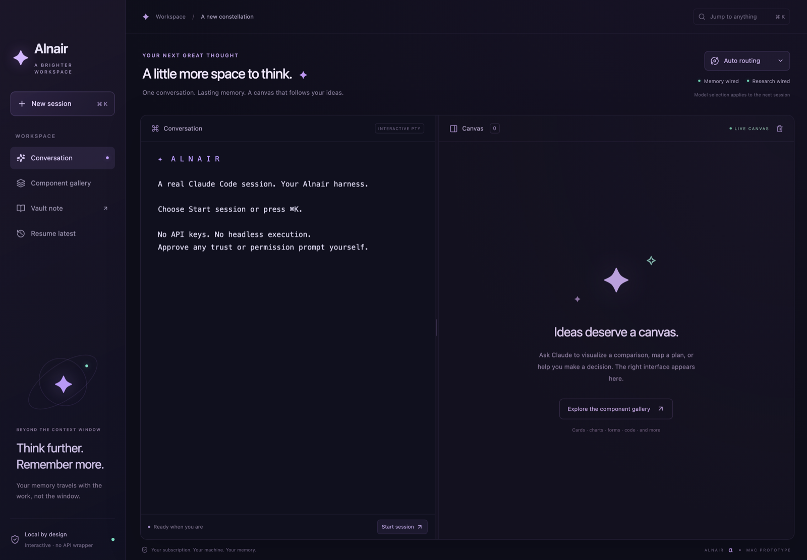

# Alnair

[](https://github.com/mahimn01/alnair/actions/workflows/ci.yml)
[](LICENSE)

A Claude Code harness that picks the model for each task, remembers what a long session settled, and checks quotes against the files they came from.

Alnair starts an ordinary interactive Claude Code session on your own subscription. It adds three plugins and a per-run settings layer, and it never edits `~/.claude`. I built it because my long sessions kept hitting the same three problems: Opus got spent on renaming variables, important facts vanished at compaction, and research answers cited pages that didn't say what the answer claimed.



*The desktop app's start screen, rendered from its web UI by `npm run screens` in `alnair-app/`. No session is running in this picture.*

## What it does

- **Model routing.** Each task goes to Sonnet, Opus or Fable based on what you asked. You can override it per launch or per task.
- **Session memory that survives compaction.** Durable facts go into a ledger under `~/.clp/sessions/<id>/`, each with a file address and a SHA-256. A read whose hash no longer matches is refused, so stale memory can't come back as fact.
- **Notes lookup with a verify gate.** CLP (Context Ledger Protocol) indexes a copy of your notes folder. Claude looks things up, reads the exact lines, and runs `verify` before presenting a claim. A claim whose quote isn't in the cited lines is refused.
- **Keyless research tools.** Papers (arXiv, OpenAlex, Crossref, Semantic Scholar), SEC filings, patents, court records, Wayback snapshots and market data, all without API keys. Research reports only pass when every quote matches the saved source word for word.
- **Session notes.** When a session stops, ends or compacts, a hook writes one Markdown note for it into your notes vault (Obsidian works). It only ever edits the notes it created.
- **Interactive only.** `-p`/`--print` is refused and there's no API-key fallback, so a session can't quietly start billing an API account.
- **Remote Control.** `alnair --remote-control` turns on Claude Code's Remote Control so you can follow a session from your phone.
- **Desktop app (prototype).** A Tauri app with a real terminal running the session and a canvas Claude can draw cards, charts and forms on.

The memory layer comes from my research on CLP. The protocol, its paper experiments and the measured results are in [mahimn01/context-ledger](https://github.com/mahimn01/context-ledger). This repo is the day-to-day harness built on it.

## Quickstart

You need macOS or Linux, Python 3.10+, Node 20+, git, and Claude Code installed with Anthropic's native installer (it lands at `~/.local/bin/claude`) and signed in once.

```sh
git clone https://github.com/mahimn01/alnair.git ~/alnair
cd ~/alnair
./install.sh
alnair doctor
alnair
```

`install.sh` links `alnair` and `claude-lab-clp` (the old name) into `~/.local/bin`, creates `~/.clp` and the run folders under `~/.local/state`, makes a Python venv inside the checkout, and writes `~/.config/alnair/config.env` once. It's safe to run again. It never writes `~/.claude/settings.json`, `~/.claude.json` or anything else under `~/.claude`.

```sh
./install.sh --vault ~/Notes          # notes folder for session notes (default ~/Documents/Obsidian Vault)
./install.sh --bin ~/bin              # put the commands somewhere other than ~/.local/bin
./install.sh --skip-python-deps       # skip the optional page-extraction package
```

To update, `git pull` and run `./install.sh` again. The lab rewrites `lab/plugin/hooks/model-catalog.js` when Claude Code advertises a new model alias, so if git refuses to pull, run `git checkout lab/plugin/hooks/model-catalog.js` first.

macOS is what I use every day. Linux should work but hasn't been tested yet.

### Windows

Windows only gets the desktop app for now. It lives on the `alnair-windows-port` branch. The port was built and installed on one Windows 11 laptop, but nobody has run a session in it yet.

```powershell
git clone https://github.com/mahimn01/alnair.git $HOME\alnair
cd $HOME\alnair
git checkout alnair-windows-port
powershell -NoProfile -ExecutionPolicy Bypass -File .\install.ps1
```

It needs Rust with the MSVC toolchain, Node 24 LTS, Python 3 on PATH, WebView2, and Claude Code installed and signed in. It installs per user under `%LOCALAPPDATA%\Programs\Alnair` with no admin rights, and `-ExecutionPolicy Bypass` only applies to that one PowerShell process. On Windows you get the terminal and the canvas. CLP memory, session notes, the research tools and automatic model routing aren't available there yet, because the launcher still assumes macOS paths and the macOS Keychain.

## Using it

```sh
alnair                        # session in the current folder
alnair "fix the flaky test"   # start with a prompt
alnair --resume latest        # pick up the last run with the same memory tools
alnair demo                   # small demo project plus a sample notes corpus
alnair doctor                 # offline readiness report, no model call
alnair --dry-run "..."        # print the exact claude command and settings, start nothing
alnair --no-research          # leave the research plugin out
alnair --remote-control       # turn on Claude Code Remote Control
alnair --remote-control=desk "fix the flaky test"   # same, with a session name
alnair install-app            # build the Rune-based Mac app into ~/Applications
alnair install-app --gui      # build the Tauri desktop app (needs Rust and Node)
```

Index your notes once so lookups have something to search. This copies the folder into `~/.clp` and never writes to the original:

```sh
~/alnair/.venv/bin/python ~/alnair/claude-clp/bin/clp_tool.py init            # your configured vault
~/alnair/.venv/bin/python ~/alnair/claude-clp/bin/clp_tool.py init ~/Notes    # or any folder
```

`--remote-control` passes Claude Code's own `--remote-control [name]` flag through. Remote Control needs Claude Code signed in with a claude.ai account and doesn't work with an API key. You can also type `/remote-control` inside a session that's already running. If you give both a name and a prompt, use the `--remote-control=NAME` form so the prompt isn't read as the name.

## Choosing a model

```sh
alnair --model auto "..."     # the default
alnair --model sonnet "..."
alnair --model opus "..."
alnair --model fable "..."
```

The choices are `auto` plus every alias in `lab/plugin/hooks/model-catalog.js`, which today means `sonnet`, `opus` and `fable`. Full model ids such as `claude-opus-5-5` are rejected, and so is `--model` after `--`, because both would skip the router. For Sonnet and Opus, Alnair hands Claude Code the alias, so `opus` always means the newest Opus your Claude Code ships. Fable is passed as the full id in the catalog (`claude-fable-5-2` right now), and the lab updates that id when a session reports a newer one.

With `auto`, the router reads your prompt:

| Prompt looks like | Model | Effort |
|---|---|---|
| long-horizon or extremely hard work: open research problems, formal verification, many repositories | Fable if available, otherwise Opus | xhigh |
| architecture, security, proofs, root causes, race conditions, anything ambiguous | Opus | xhigh |
| brokerage or options-trading work | Sonnet, plus a required Opus review | high |
| everything else | Sonnet | medium |

Start `alnair` with no prompt and your first message picks the model. Inside a session, `/lab-model auto|sonnet|opus|fable` sets the model for the next task, and adding `now` switches straight away. Subagents get Opus for review and hard reasoning and Sonnet for the rest. An explicit Haiku or Sonnet request for a subagent is kept.

Fable is gated. `alnair fable-check` looks in your local Claude Code transcripts for an interactive Fable reply from the last 7 days and enables Fable only if it finds one. `alnair fable-check --enable` or `--disable` overrides that by hand. The check makes no model call.

New models show up on their own. Once a day, or right away when the Claude Code binary changes, Alnair reads the aliases listed in `claude --help` and adds any new one to the catalog, after which it's a valid `--model` choice. `alnair update` forces that check. Auto-routing only picks Sonnet, Opus or Fable, so a new alias has to be chosen by name.

## Settings

`~/.config/alnair/config.env` holds `KEY=VALUE` lines. Anything exported in your shell wins over the file.

| Key | Default | What it changes |
|---|---|---|
| `ALNAIR_VAULT` | `~/Documents/Obsidian Vault` | where session notes go, and what `clp_tool.py init` indexes by default |
| `CLP_STORE` | `~/.clp` | corpus copies and session ledgers |
| `RESEARCH_HOME` | `~/.clp/research` | saved research sources and claims |
| `RESEARCH_MAILTO` | unset | contact address sent to Crossref, OpenAlex and SEC. SEC full-text search wants one |
| `ALNAIR_TZ` | `America/Toronto` | time zone used in session note titles |
| `ALNAIR_LAB_ROOT` | `lab/` in the checkout | use a different copy of the lab shell |
| `CONTEXT_LEDGER_RESEARCH_API_KEY` | unset | only for the optional paid `clp ask` command. Sessions never use it |

The desktop app reads `ALNAIR_VAULT` from its environment only. Launched from the Dock with a custom vault, its "open note" button still looks in the default folder.

## How it compares

**Plain Claude Code.** Alnair is Claude Code. It adds routing, the memory and research plugins, session notes and a status line, and it runs them from a per-run settings layer. Your normal `claude` command and settings stay exactly as they were.

**Memory plugins that summarise past sessions.** Those inject recalled text that the model can't check. Alnair's memory is addressed: every fact points at a file, a line range and a hash, and the verify gate refuses a quote that isn't there. Recall is weaker in exchange, because nothing gets remembered that wasn't written down.

**context-ledger.** [context-ledger](https://github.com/mahimn01/context-ledger) is the research code and paper for CLP. Alnair ships the same library in `src/context_ledger/` and uses it for notes lookup and the gate.

## FAQ

**Does it use my API key?** No. Sessions run on your Claude Code login. The only paid path is the optional `clp ask` command, which reads `CONTEXT_LEDGER_RESEARCH_API_KEY` and stops at a $5 daily cap.

**Will it change my Claude Code settings?** No. It reads `~/.claude/settings.json` to build the run's layer and passes that layer with `--settings`. The test suite checks that a launch leaves those files byte-identical.

**Why no headless mode?** The subscription I built it on refuses headless calls with a 403, and silently falling back to an API key is how surprise bills happen.

**Does it need Obsidian?** No. Any folder of Markdown, text or Python files works as the notes corpus, and session notes are plain Markdown.

**Is the desktop app ready?** It's a prototype. The CLI is what I use every day.

## Roadmap

- run a real session in the Windows build, then bring CLP memory and routing to Windows
- test and document Linux properly, including account switching without the macOS Keychain
- sign and notarise the Mac app
- let auto-routing consider newly discovered model aliases
- read `config.env` from the desktop app so a custom vault works when it's launched from the Dock

## Repo layout

- `claude-mem/` holds the `alnair` launcher (`bin/claude-lab-clp`), the routing benchmark, the Rune terminal layout and the Mac app builder
- `lab/` is the session layer: launcher, model router, status line and the optional account switcher ([lab/README.md](lab/README.md))
- `claude-clp/` is the CLP plugin, the session ledger and the session note hook
- `claude-research/` is the research plugin and its MCP server
- `src/context_ledger/` is the CLP library
- `alnair-app/` is the Tauri desktop app

## Contributing

Bug reports and pull requests are welcome. [CONTRIBUTING.md](CONTRIBUTING.md) covers running the tests (none of them start a Claude session), and [SECURITY.md](SECURITY.md) says how to report a vulnerability privately.

MIT licensed. See [LICENSE](LICENSE).
